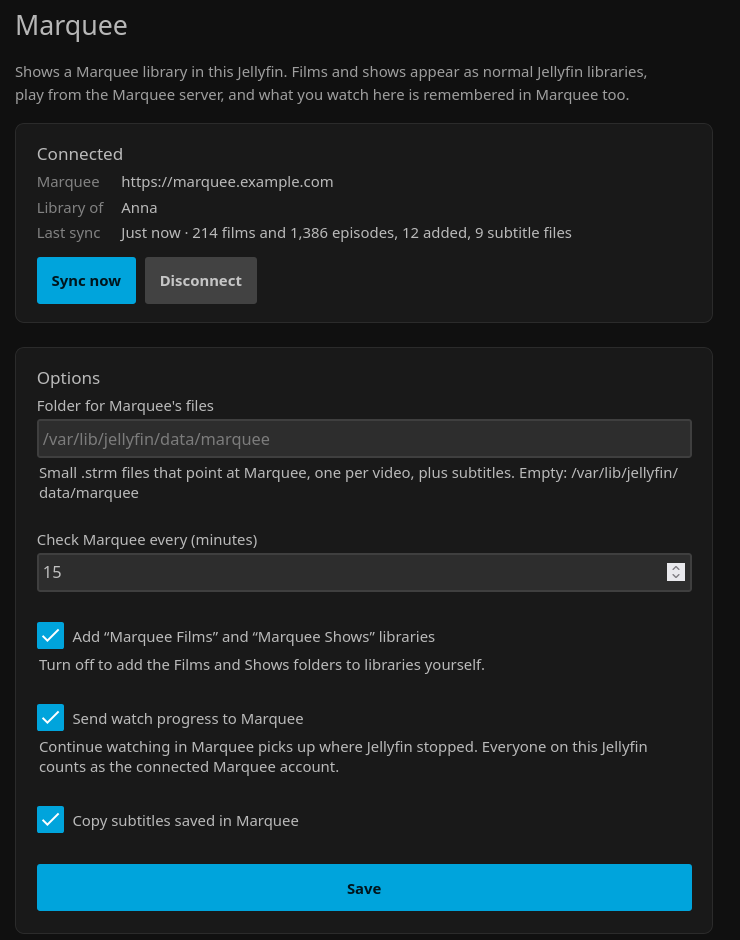

# Lilin for Jellyfin

[](https://github.com/Tjabooo/jellyfin-plugin-lilin/actions/workflows/ci.yml) [](https://github.com/Tjabooo/jellyfin-plugin-lilin/releases) [](LICENSE)

Watch your [Lilin](https://github.com/Tjabooo/lilin) library in your own Jellyfin. Install the plugin on your Jellyfin server, enter a code in Lilin, and your films and shows show up as normal Jellyfin libraries in every Jellyfin app: TVs, phones, Kodi, the web. Playback streams from the Lilin server, and what you watch is remembered in Lilin too.



## Features

- **Sign in with a code.** The plugin shows a six-character code; you enter it in Lilin under **Settings → Jellyfin**. No passwords or keys to copy around.
- **Real Jellyfin libraries.** Each film and episode becomes a small `.strm` file in Jellyfin's naming (`Films/Heat (1995) [tmdbid-949]/Heat (1995).strm`, `Shows/The Bear (2022) [tmdbid-136315]/Season 01/The Bear S01E02.strm`), so Jellyfin fetches posters, descriptions and episode details itself, and its own apps, users, collections and resume work as usual.
- **Libraries made for you.** "Lilin Films" and "Lilin Shows" are added on the first sync (or point your own libraries at the folders).
- **Stays in step.** Every 15 minutes (adjustable) new downloads appear and titles that left Lilin disappear. Videos Lilin converts to MP4 keep working.
- **Subtitles.** Subtitles saved in Lilin are copied beside each video, and fetched again for a couple of days after a download while Lilin fixes their timing.
- **Progress goes back to Lilin.** Watching in Jellyfin updates Continue watching in Lilin; finishing something clears it there.
- **Your Jellyfin does the heavy lifting.** If a device needs a different format, your Jellyfin server converts it, not the Lilin server.
- **Safe links.** Each `.strm` file holds a link signed for that one video. A leaked file opens one video, never the account, and disconnecting (in either place) kills every link at once.
- **Jellyfin 12 and 10.11.** One plugin repository serves the right build to each.

## Install

1. In Jellyfin, open **Dashboard → Plugins → Repositories** (or the ⚙ on the Catalog page) and add a repository:
   - Name: `Lilin`
   - URL: `https://raw.githubusercontent.com/Tjabooo/jellyfin-plugin-lilin/main/manifest.json`
2. Open the **Catalog**, find **Lilin** and install it.
3. Restart Jellyfin.

Manual install: download the zip for your Jellyfin version from [Releases](https://github.com/Tjabooo/jellyfin-plugin-lilin/releases) (`…12.zip` for Jellyfin 12, `…10.zip` for 10.11), unzip it into a `Lilin` folder inside Jellyfin's `plugins` folder and restart Jellyfin.

## Usage

1. In Jellyfin, open **Dashboard → Plugins → Lilin** (also in the dashboard's side menu).
2. Enter the address you open Lilin at, like `https://lilin.example.com`, or the home-network address (`http://192.168.1.10:8080`) when Jellyfin is in the same house. A bare `192.168.1.10:8080` is fine too.
3. Press **Get a code**.
4. In Lilin, open **Settings**, find **Jellyfin** and enter the code.

The plugin syncs straight away. Films and shows appear once Jellyfin has scanned them, usually within a minute or two. **Sync now** runs it again; **Disconnect** removes the library and its files from this Jellyfin.

In Lilin, **Settings → Jellyfin** lists every connected Jellyfin server with when it last synced, and **Disconnect** cuts one off.

## Configuration

All on the plugin's settings page:

| Setting | Default | What it does |
| --- | --- | --- |
| Folder for Lilin's files | Jellyfin's data folder + `/lilin` | Where the `.strm` and subtitle files go. Changing it removes the files from the old folder. |
| Check Lilin every | 15 minutes | How often the library is synced (5 minutes to a day). Also under **Dashboard → Scheduled Tasks → Lilin**. |
| Add "Lilin Films" and "Lilin Shows" libraries | On | Turn off to add `<folder>/Films` and `<folder>/Shows` to libraries yourself. |
| Send watch progress to Lilin | On | Everyone on this Jellyfin counts as the connected Lilin account. |
| Copy subtitles saved in Lilin | On | Saves them beside each video as `Name.<language>.srt`. |

## How it works

The plugin talks to Lilin's `/c/jf/v1` API:

1. **Pairing.** `POST /c/jf/v1/pair/start` returns a code and a secret poll id. Once someone signed in to Lilin enters the code, `GET /c/jf/v1/pair/poll` hands the plugin a key, exactly once. Lilin stores only a hash of it.
2. **Library.** `GET /c/jf/v1/library` (with the key) lists that person's films and episodes with TMDB ids, saved subtitle languages and Continue watching positions. Each video comes with a stream path signed (HMAC) for that video and this connection.
3. **Files.** The plugin writes one `.strm` file per video and records what it wrote in `.lilin-sync.json`. Only files listed there are ever changed or deleted; anything else in the folder is left alone. Jellyfin is told about the folders that changed.
4. **Playback.** Jellyfin opens the signed URL like any network stream: seeking uses HTTP range requests, and Jellyfin converts the video if a device needs it.
5. **Progress.** While something from Lilin plays, the position is sent to `POST /c/jf/v1/progress` every 30 seconds and when it stops; Jellyfin's "played" sends it as finished.

Everything lives under Lilin's `/c/` path, which a Lilin behind Cloudflare Access already lets through without a Cloudflare sign-in (see Lilin's `docs/remote-access.md`); Lilin checks the key or the signature itself. It needs a Lilin recent enough to have **Settings → Jellyfin**.

## Building

Needs the .NET 10 SDK.

```bash
dotnet build Jellyfin.Plugin.Lilin/Jellyfin.Plugin.Lilin.csproj -c Release   # net10.0 (Jellyfin 12) and net9.0 (10.11)
dotnet test Jellyfin.Plugin.Lilin.Tests
python3 scripts/package.py v0.1.0 --repo you/jellyfin-plugin-lilin            # dist/*.zip + manifest.json entries
```

Publishing a GitHub release does the packaging in CI, attaches the zips and updates `manifest.json`.

## License

GPL-3.0, like Jellyfin, whose libraries the plugin builds on.
